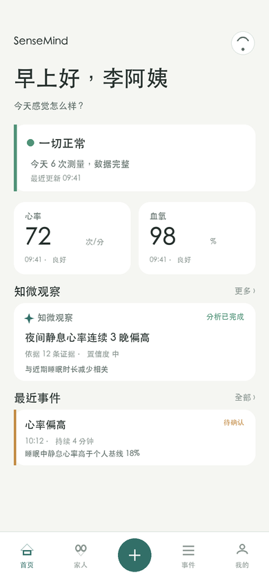
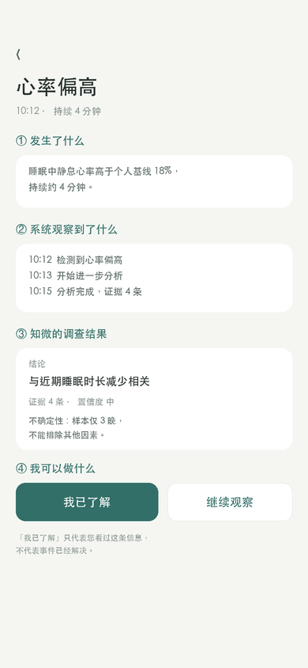
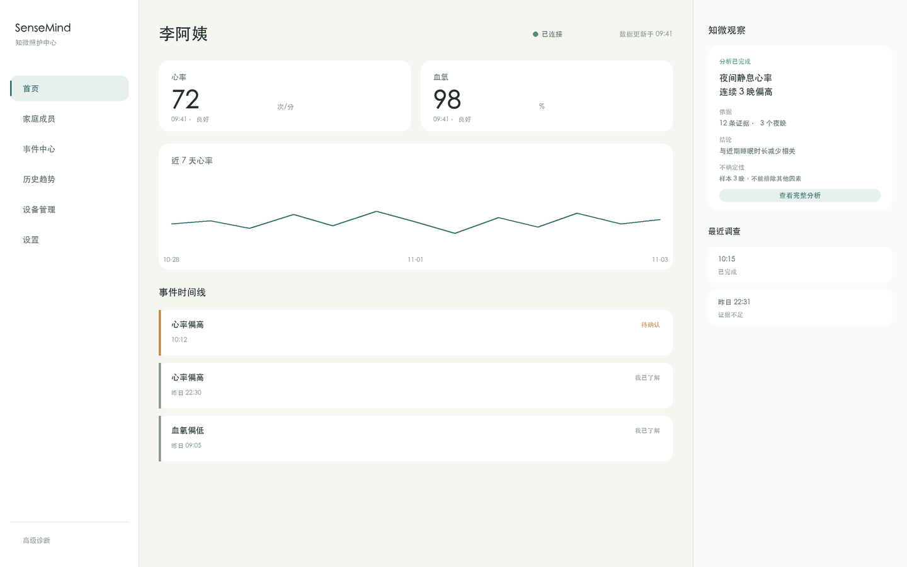

# 知微 SenseMind

**端侧多模态监护智能体** — 毫米波雷达 + 可穿戴 PPG + 只读调查 Agent + 家长端 App。

本仓库是知微 SenseMind 的**核心源码与硬件设计**：智能体后端（Python / FastAPI）、Android 客户端（Kotlin / Compose）、手表固件（Zephyr / nRF52840）、参数化结构脚本（build123d），以及原理图、BOM、结构图纸等硬件设计文件。

> ⚠️ **研究与黑客松原型，不是医疗器械。** 不具备经过验证的癫痫发作识别能力，不用于真实健康监护、诊断、治疗或紧急报警。详见下方[免责声明](#免责声明)。

<p align="center">
  
  
  
</p>

---

## 一、它是什么

不做"又一个健康手环"，而是把三条线接起来：**感知 → 判断 → 只给该给的人看**。

| 层 | 内容 | 本仓库对应 |
|---|---|---|
| **感知层** | 60 GHz 毫米波雷达（LD6002 系列）做呼吸/心率/体动主通道；nRF52840 手表做第二路心率与体动；ESP32 做床边雷达终端 | `03_硬件_结构图纸_CAD/04_模块固件与结构交接/01_手表固件_Zephyr/`、`02_硬件_原理图与PCB/` |
| **智能体层** | FastAPI 后端 + DeepSeek 自主调查 Agent：先判信号可用性，再结合整夜基线、阈值表与只读工具调用，输出「静默记录 / 轻提示 / 叫醒家长」并附证据链 | `01_智能体_Agent/SenseMind-Agent/guardian/` |
| **呈现层** | Android 家长端 / 佩戴端（Compose）+ 本地监控控制台 | `01_智能体_Agent/SenseMind-Agent/android/`、`04_软件_App与UI/` |

**核心主张**：原始数据不出户、不依赖 GPU 与云；同一运行时加载不同 profile，可切到儿童夜间监护 / 老人离床跌倒 / 成人睡眠呼吸事件。

### 几个实现上的取舍

- **证据链优先**：Agent 输出不是一个"异常"标签，而是结构化证据（触发时刻、前后窗口、信号质量、相似事件、多传感器对照）。模型不可用、超时或输出非法工具调用时，退回本地确定性调查，不会静默失败。
- **只读边界**：AI 没有确认、取消告警的权限；规则引擎产生事件，人做最终确认，所有工具调用有白名单、设备范围绑定、次数与输出长度限制，审计表不存密钥和原始对话。
- **两套入口**：`guardian.main:app` 是本机完整功能；`guardian.public:app` 只暴露已认证的手机 `/v1` 契约与 `/healthz`，给隧道用，不暴露遥测、文档和内部接口。
- **端侧可跑**：结构、固件、后端、App 都能在本机（Mac / Linux + 一块 nRF52840 开发板）跑起来，不需要 GPU。

---

## 二、仓库结构

```
SenseMind-Core/
├── 01_智能体_Agent/SenseMind-Agent/   ★ FastAPI + DeepSeek 自主调查智能体
│   ├── guardian/                      检测引擎、决策引擎、证据链、调查 Agent、LLM、APK 契约层
│   ├── android/                       Android 客户端（Kotlin + Compose，Gradle 工程）
│   ├── tests/                         230 条测试（决策引擎 / 时间基 / 契约 / 回放 / 端到端）
│   ├── scripts/                       数据回放、演示数据发送、训练与质量审计
│   ├── docs/                          架构、决策引擎、验收报告、质量与稳定性审计
│   ├── experiments/ runs/             实验索引与运行记录（JSON）
│   └── .env.example                   环境变量样例
│
├── 02_硬件_原理图与PCB/                ★ 双板硬件设计
│   ├── 01_原理图与EDA工程/            嘉立创 EDA 专业版原生工程
│   ├── 02_BOM与网表/                  BOM（xlsx/csv）、网表、原理图 PDF 全集
│   ├── 04_设计交接文档/               原理图设计交接、资料核对与缺项清单
│   └── 05_画图脚本与审计工具/         EasyEDA 画图脚本与硬件审计脚本
│
├── 03_硬件_结构图纸_CAD/               ★ 结构设计
│   ├── 01_交付总包_SenseMind-CAD/     STEP / STL / 工程图 PDF / 预览 / 交互爆炸图
│   ├── 02_参数化源文件/               build123d 参数化建模源码 + watch_v1_params.json
│   ├── 04_模块固件与结构交接/
│   │   ├── 01_手表固件_Zephyr/        nRF52840 手表固件（C，Zephyr 4.5）
│   │   └── 02_模块结构交接/           模块结构概念与 CAD 交接
│   └── 07_电子装配工程_V1/            整机装配工程（文档 + 表格 + A2 DXF 图纸 + 生成脚本）
│
└── 04_软件_App与UI/
    ├── 02_UI设计系统/                 设计系统 v2.0、UI 审计、改造报告
    └── 04_界面预览/                    页面与组件预览图
```

---

## 三、快速开始

### 3.1 智能体后端（Python 3.11+）

```bash
cd 01_智能体_Agent/SenseMind-Agent
python3 -m venv .venv
source .venv/bin/activate
python -m pip install -r requirements.txt
cp .env.example .env          # 填入自己的 DEEPSEEK_API_KEY；不填则走本地确定性回落
python -m pytest -q
uvicorn guardian.main:app --reload --host 127.0.0.1 --port 8000
```

- 交互接口文档：<http://127.0.0.1:8000/docs>
- 本地监控控制台：<http://127.0.0.1:8000/console>
- macOS 也可以直接双击 `启动Mac上位机.command`（首次运行会自动建环境、装依赖）。

另开一个终端发一组演示数据，看规则事件与 Agent 自动调查：

```bash
source .venv/bin/activate
python scripts/send_demo.py --scenario abnormal
```

然后查看 <http://127.0.0.1:8000/v1/events?device_id=guardian_001> 与监控控制台。

> 没有 DeepSeek Key 也能跑：`GUARDIAN_LLM_MODE` 保持默认时，模型不可用会明确退回本地只读查询，不会伪造结论。

### 3.2 Android 客户端（JDK 17 + Android SDK 35）

```bash
cd 01_智能体_Agent/SenseMind-Agent/android
export JAVA_HOME=/opt/homebrew/opt/openjdk@17     # 换成你的 JDK 17
export ANDROID_HOME="$HOME/Library/Android/sdk"
./gradlew :app:assembleDebug :app:testDebugUnitTest
adb install -r app/build/outputs/apk/debug/app-debug.apk
```

App 与后端的配对流程、`/v1` 契约、授权与安全边界见 [`android/README.md`](01_智能体_Agent/SenseMind-Agent/android/README.md)。

### 3.3 手表固件（Zephyr 4.5 / nRF52840）

```bash
cd 03_硬件_结构图纸_CAD/04_模块固件与结构交接/01_手表固件_Zephyr
west build -b promicro_nrf52840/nrf52840/uf2 -d build
# 产物可直接拖进 UF2 磁盘烧录
```

板级 overlay 在 `boards/`，UI 与传感器行为见 `docs/H3-05-UI.md`、`docs/design.md`。

### 3.4 结构 CAD（build123d）

```bash
pip install build123d trimesh matplotlib pymupdf
cd 03_硬件_结构图纸_CAD/02_参数化源文件
python watch_v1_cad.py --out .     # 由 watch_v1_params.json 重新生成 STEP / STL / 参数表
python watch_v1_docs.py            # 出三视图 / 剖面 / 爆炸图
python watch_v1_preview.py         # 单件预览 PNG
```

所有几何由 `watch_v1_params.json` 一处数据驱动，改数字重跑即可；**第一件建议先打 `watch_v1_fit_check.stl`**。厚链计算与设计约束见该目录 `README.md`。

---

## 四、硬件设计

- **板卡**：Board1 为 nRF52840 手表主板（MAX30102 PPG + MPU6050 IMU + ST7789V 屏 + 电源与调试），Board2 为 ESP32 床边雷达接口板。
- **格式**：原理图工程为嘉立创 EDA 专业版原生 `.eprj2`，同时提供分页 `.esch`、网表 `.net`、BOM（xlsx / csv）与 PDF 全集，不装 EDA 也能看。
- **结构**：参数化 build123d 源码 + STEP（B-rep）+ STL + 工程图 PDF + 可编辑 DXF + 交互爆炸图。
- **装配**：`07_电子装配工程_V1/` 含空间核对、引脚分配、线束、供电安全检查、装配顺序、上电前检查清单与联调计划。

> 结构为 **V1 概念件，尺寸未冻结**（总厚 21.9 mm）。装配工程里列了 5 处硬冲突（屏排针、电池压天线、电池厚度、线束通道等），其中 C2 属设计级 RF 风险，只报告不改壳 —— 这些都是公开记录，欢迎接手改进。

---

## 五、测试与验证

```bash
cd 01_智能体_Agent/SenseMind-Agent
python -m pytest -q
```

`tests/` 覆盖决策引擎、时间基、APK `/v1` 契约、证据链、端到端 uvicorn 进程与回放。机器学习部分（`scripts/train_*.py`、`scripts/replay_dataset.py`）需要自行下载公开数据集：

- **PPG-DaLiA**（UCI）：PPG 心率/呼吸研究回放
- **PAMAP2**（UCI）：活动识别模型训练（仓库记录的活动模型测试准确率 75.0%，macro F1 73.9%）

数据集不随仓库分发，下载后按 `01_智能体_Agent/SenseMind-Agent/data/README.md` 放置。

---

## 六、没有放进来的东西

这是"源码 + 硬件设计"仓库，不是完整归档。以下内容**有意排除**：

| 内容 | 原因 |
|---|---|
| 真实受试者雷达 / PPG 采集数据 | 敏感生理信息，需去标识化与知情同意覆盖"公开" |
| 器件手册与厂家资料（MAX30102、LD6002、nRF52840 等 PDF/压缩包） | 版权归各原厂，仅需自行从官方渠道获取 |
| APK / UF2 / 模型权重等二进制产物 | 可由本仓库源码重新构建 |
| 路演 PPT、演示视频、参赛材料 | 含队员个人信息与第三方素材，与源码无关 |
| Blender 渲染图、专利附图 | 体积较大，且图样在申请前公开有风险；`源文件/` 里脚本可自行重出 |

中文字体同理：装配图纸 DXF 里引用的 `SenseMindCJK.ttf` 是从本机字体裁出的子集，授权不允许再分发，运行一次 `05_源文件_可重跑/mkfont.py` 即可在本地生成。

---

## 七、第三方组件

运行时不随仓库分发、需要自行安装的主要依赖：[FastAPI](https://github.com/fastapi/fastapi)（MIT）、[Pydantic](https://github.com/pydantic/pydantic)（MIT）、[pytest](https://github.com/pytest-dev/pytest)（MIT）、[build123d](https://github.com/gumyr/build123d)（Apache-2.0）、[Zephyr RTOS](https://zephyrproject.org/)（Apache-2.0）、[Jetpack Compose](https://developer.android.com/jetpack/compose)（Apache-2.0）、[Blender](https://www.blender.org/)（GPL，可选渲染）、DeepSeek API（商业服务条款）。

完整清单、数据来源与商标归属见 [`THIRD_PARTY.md`](THIRD_PARTY.md)。

---

## 免责声明

本项目为研究与黑客松演示原型，**不是医疗器械**，未做临床验证，不得用于诊断、治疗或紧急报警。仓库内的雷达/PPG 数据量与标注不足以训练或声称临床级检测能力；仓库中的规则阈值与调查结论均为工程演示，不构成任何医疗建议。

如果你或家人存在健康风险，请使用经过认证的医疗设备并咨询医生。

---

## 许可证

代码与文档以 [MIT License](LICENSE) 发布。第三方组件、数据集、厂商资料遵循各自许可，见 [`THIRD_PARTY.md`](THIRD_PARTY.md)。

---

<sub>English: SenseMind (知微) is a prototype on-device multimodal monitoring agent — 60 GHz radar + wearable PPG, a read-only investigation agent with an evidence chain, an Android caregiver app, Zephyr firmware, and a parametric CAD watch design. Research/hackathon prototype, **not a medical device**. MIT licensed.</sub>
